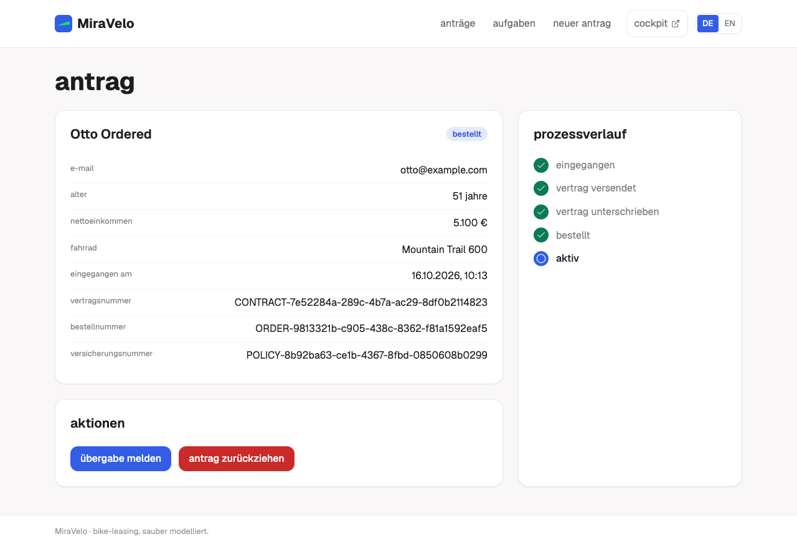
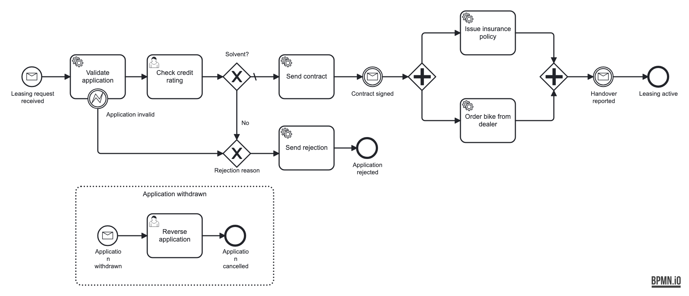

# MiraVelo bike leasing

[](https://github.com/miragon-blueprints/miragon-ai-example/actions/workflows/pre-merge.yml)
[](LICENSE)

A solution template for process automation with AI agents. On one small but complete process, it
shows how we at Miragon get from the business picture to a running application: a BPMN model on an
embedded [CIB seven](https://cibseven.org) engine, a Kotlin service and a React frontend around it,
and the design artifacts that explain them, in one repository that people and agents work on
together.



## Why

Agents write code fast. What they don't know on their own is which process the code serves, which
rules it has to keep and what comes next. In most projects that knowledge is spread across workshop
boards, wikis, tickets and code. This template keeps it in one place and makes it checkable:

- **From the business picture to running code.** Use case, glossary, t.BPM model, feature map, C4
  and Wardley Map sit in [`docs/`](docs/README.md) next to the executable BPMN. designIQ shows them,
  and Gradle deploys the model from the same folder, so every layer traces back to a process step.
- **The process model is the contract.** A typed process API is generated from the BPMN, so code
  that references a removed element no longer compiles, and the process tests walk its paths.
- **Guardrails, not only reviews.** Architecture tests, a mutation gate, bpmnlint and drift gates on
  the OpenAPI contract and the frontend client fail the build when a change breaks a rule, whether a
  person or an agent wrote it.
- **The next work sits on the model.** The gap to the target process is a set of GitHub issues
  anchored to BPMN elements, shown as todos on the model. [AGENTS.md](AGENTS.md), the skills and the
  review agents in `.claude/` take an agent from such an issue to a pull request.
- **A starting point to fork.** A real UI for customers and the back office, operations in the
  Cockpit with retries and incidents, CI and containers: replace the process and keep the rest.

## The process



A customer applies to lease a bike. The application is validated, the back office checks the credit
rating, and a solvent customer receives the contract. Once it is signed, the insurance policy is
issued and the bike is ordered from the dealer in parallel. When the dealer reports the handover,
the leasing is active. Until then the customer can withdraw; the back office then reverses the
application.

The model deliberately leaves out what the
[original process](docs/use-cases/bike-leasing/original/scope-comparison.md) could do. That gap is
the roadmap below.

## Quick start

Requires JDK 21, Node 24 and Docker or Podman.

```bash
docker compose -f stack/docker-compose.yml up -d   # PostgreSQL on :5432
./gradlew bootRun                                  # service + embedded engine on :8081
npm --prefix frontend ci && npm --prefix frontend run dev   # frontend on :5173
```

| What | URL | Login |
|---|---|---|
| Frontend (applications, new application, back-office inbox) | <http://localhost:5173> | |
| CIB seven Cockpit (operations) | <http://localhost:8081/webapp/#/seven/auth/start> | admin / admin |
| Swagger UI | <http://localhost:8081/swagger-ui.html> | |

Demo cases in every state: `cd bruno && npx --yes @usebruno/cli@4.0.0 run 00-demo-data --env local`.
Everything else (tests, containers, reset) is in [CONTRIBUTING.md](CONTRIBUTING.md).

## What's inside

| Path | Content |
|---|---|
| [`service/`](service/app/src/main/kotlin/io/miragon/blueprint/) | Spring Boot 4 service in Kotlin, hexagonal, with JavaDelegates on the embedded engine, and the reusable architecture rules |
| [`frontend/`](frontend/AGENTS.md) | React app (Vite, TanStack, Tailwind) with a client generated from the OpenAPI contract |
| [`docs/`](docs/README.md) | the designIQ workspace: use case, glossary, t.BPM, feature map, the executable model, C4, Wardley Map, ADRs |
| [`openapi/`](openapi/openapi.json) | the checked-in REST contract |
| [`bruno/`](bruno/README.md) | REST scenarios and demo data |
| [`.claude/`](.claude/README.md) | skills and review agents for Claude Code |

## Roadmap

What the original process could do and this one cannot yet, ordered by stage
([feature map](docs/use-cases/bike-leasing/feature-map/feature-map.md)):

| Stage | Feature |
|---|---|
| 1 – Customer follow-up | [#18 Reject the application when the contract stays unsigned for 14 days](https://github.com/miragon-blueprints/miragon-ai-example/issues/18) |
| 1 – Customer follow-up | [#1 Remind the customer to sign the contract after 7 days](https://github.com/miragon-blueprints/miragon-ai-example/issues/1) |
| 2 – Automation and supply | [#19 Automate the credit check with the DMN checkCreditRating](https://github.com/miragon-blueprints/miragon-ai-example/issues/19) |
| 2 – Automation and supply | [#20 Clarify an alternative bike when the dealer cannot deliver](https://github.com/miragon-blueprints/miragon-ai-example/issues/20) |
| 3 – Withdrawal | [#21 Activate the leasing only after the 14-day withdrawal period](https://github.com/miragon-blueprints/miragon-ai-example/issues/21) |
| 3 – Withdrawal | [#3 Reverse a withdrawn application automatically instead of by hand](https://github.com/miragon-blueprints/miragon-ai-example/issues/3) |
| 3 – Withdrawal | [#4 Cancel a placed bike order at the dealer](https://github.com/miragon-blueprints/miragon-ai-example/issues/4) |
| 4 – Portal | [#7 Show live dealer availability in the bike catalogue](https://github.com/miragon-blueprints/miragon-ai-example/issues/7) |

Open sourcing decisions (make, buy or adapt; [sourcing decisions](docs/architecture/sourcing-decisions.md)):
[#8 contract and e-signature](https://github.com/miragon-blueprints/miragon-ai-example/issues/8),
[#9 customer notifications](https://github.com/miragon-blueprints/miragon-ai-example/issues/9),
[#10 dealer integration](https://github.com/miragon-blueprints/miragon-ai-example/issues/10).

## Documentation

- [AGENTS.md](AGENTS.md): structure, rules, commands and how to implement a feature issue
- [docs/README.md](docs/README.md): every design artifact, the demo order and the ADR list
- [Executable process](docs/use-cases/bike-leasing/process/executable-process.md): element ids,
  what differs from its source model, how a model change reaches the code
- [Demo script](docs/demo/demo-script.md): the live demo, step by step
- [frontend/AGENTS.md](frontend/AGENTS.md): the frontend's structure and rules

## Contributing

See [CONTRIBUTING.md](CONTRIBUTING.md).

## License

[MIT](LICENSE) © Miragon GmbH.
