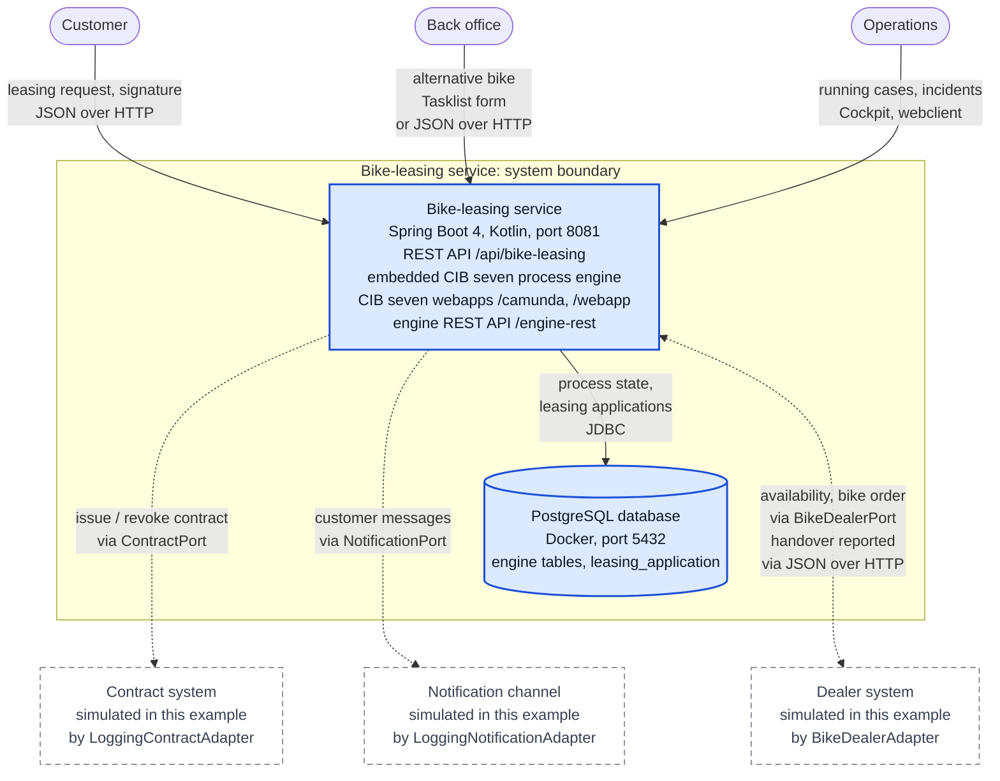
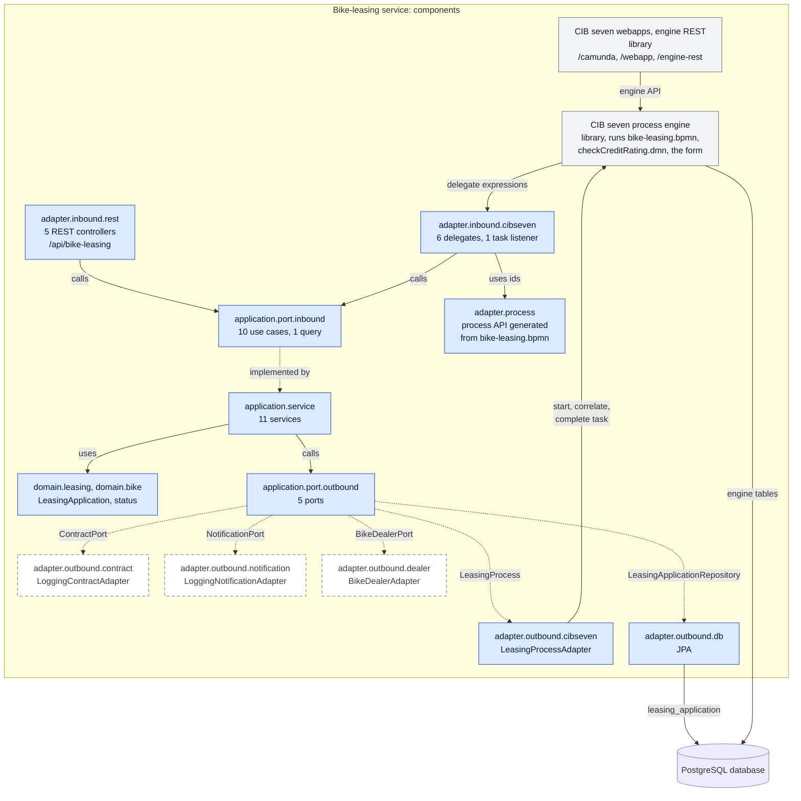

# C4 containers and components (Level 2 and 3): bike-leasing service

designIQ shows this file as plain text; GitHub renders the diagrams.

This view zooms into the one box of the [system context](c4-system-context.md): first the containers,
then the components inside the service. It draws only what runs today.

## Container view (Level 2)

A C4 container is a unit you deploy and run on its own. The REST API, the CIB seven process engine
and the CIB seven webapps run in one Spring Boot application, in one JVM, from one jar. So they are
one container, the Bike-leasing service; its parts are in the
[component view](#component-view-level-3). The second container is the PostgreSQL database.

Dashed: simulated in this example. The invisible `~~~` links only keep the external systems below
the boundary.

| Element | What it is | Origin in the process | Source in the repo |
|---|---|---|---|
| Bike-leasing service | Spring Boot 4 application in Kotlin (JVM 21), started with `./gradlew bootRun` on port 8081. Serves the REST API `/api/bike-leasing` (Swagger UI `/swagger-ui.html`), Cockpit, Tasklist and Admin at `/camunda`, the webclient at `/webapp` (both admin/admin), the engine REST API `/engine-rest` and Actuator `/actuator`. | Deploys and runs `bike-leasing.bpmn`, `checkCreditRating.dmn` and the form `clarify-alternative.form`; every step of the process runs here. | [build.gradle.kts][build], [application.yaml][yaml], [CibsevenBikeLeasingApplication][main] |
| PostgreSQL database | `postgres:18.6` in Docker, port 5432, database `bikeleasing`. Holds the engine's own tables and the table `leasing_application` (Flyway). Engine and services write in one transaction. Tests use in-memory H2 instead. | The wait states persist here: Contract signed or 14 days, Handover reported, Await end of withdrawal period. So does the status of each case. | [docker-compose.yml][compose], [V1__init.sql][v1], [V2__drop_bike_portfolio.sql][v2] |

The external systems are described in the [system context](c4-system-context.md#elements).

### From process elements to containers

| Process element | Where it lives today |
|---|---|
| Start event Leasing request received | REST API of the service; no portal yet ([#6][i6], [#7][i7]) |
| Service tasks, gateways, Check credit rating | Delegates and application services in the service; the DMN table runs in the engine |
| Wait states: Contract signed, 14 days, Handover reported, Await end of withdrawal period | The process engine; their state is in PostgreSQL |
| User task Clarify alternative with customer | CIB seven Tasklist form, or the REST API ([#11][i11]) |
| External parties: contract, notification, dealer | Outside the boundary, simulated ([#8][i8], [#9][i9], [#10][i10]) |

## Component view (Level 3)

Inside the Bike-leasing service. Every blue box is a package under
`src/main/kotlin/io/miragon/blueprint/`; the two grey boxes are CIB seven libraries; the dashed boxes
are the packages of the simulated adapters. Solid arrows: calls or uses. Dotted arrows: implemented by. The architecture
tests ([ArchitectureTest][arch]) enforce these directions.

| Component | What it is | Origin in the process | Source in the repo |
|---|---|---|---|
| `adapter.inbound.rest` | 5 controllers on `/api/bike-leasing`. Errors become problem details: 400 invalid input, 404 unknown application or no open task, 409 wrong state. Also the metadata of the [OpenAPI contract][openapi]. | Leasing request received, Contract signed, Clarify alternative with customer, Handover reported; reading one application | [adapter/inbound/rest][pkg-rest] |
| `adapter.inbound.cibseven` | 6 JavaDelegates the engine calls by delegate expression, such as `#{sendContractDelegate}`; 1 task listener that logs each new clarification task. | Send contract, Cancel contract, Send rejection, Order bike from dealer (turns "out of stock" into the BPMN error Bike unavailable), Send cancellation confirmation, Leasing active; the listener sits on Clarify alternative with customer | [adapter/inbound/cibseven][pkg-delegates] |
| `application.port.inbound` | One interface per use case: 10 use cases and the query `GetLeasingApplicationQuery`. | Called over REST: submit, get, sign contract, select alternative, report handover. Called by the engine: send contract, cancel contract, reject, order bike, send cancellation confirmation, activate leasing. | [application/port/inbound][pkg-in] |
| `application.service` | One service per use case; transactional, so domain writes and engine state commit together. | The same steps | [application/service][pkg-service] |
| `domain.leasing`, `domain.bike` | `LeasingApplication` with its status and value objects; `BikeUnavailableException`. | The status follows the process: RECEIVED, ORDERED, HANDED_OVER, ACTIVE (Leasing active), or REJECTED (Application rejected), CANCELLED (Contract cancelled) | [domain][pkg-domain] |
| `application.port.outbound` | 5 ports the services call: `LeasingApplicationRepository`, `LeasingProcess`, `ContractPort`, `NotificationPort`, `BikeDealerPort`. | See the adapters below | [application/port/outbound][pkg-out] |
| `adapter.outbound.db` | JPA entity, mapper and repository for the table `leasing_application`. | Keeps the status of each case | [adapter/outbound/db][pkg-db] |
| `adapter.outbound.cibseven` | `LeasingProcessAdapter`: starts the process by message, correlates messages by business key (the application id), completes the user task. | Leasing request received, Contract signed, Handover reported, Clarify alternative with customer | [adapter/outbound/cibseven][pkg-cib] |
| `adapter.outbound.contract` | `LoggingContractAdapter` simulates the contract system: it logs and returns `CONTRACT-<uuid>`. | Send contract, Cancel contract | [adapter/outbound/contract][pkg-contract] |
| `adapter.outbound.notification` | `LoggingNotificationAdapter` simulates the notification channel: it logs the message. | Send contract, Send rejection, Send cancellation confirmation | [adapter/outbound/notification][pkg-notification] |
| `adapter.outbound.dealer` | `BikeDealerAdapter` simulates the dealer system: `BIKE-OOS` is out of stock, `BIKE-FAIL` is an outage, every other bike gets `ORDER-<uuid>`. | Order bike from dealer, Bike unavailable | [adapter/outbound/dealer][pkg-dealer] |
| `adapter.process` | Process API that bpmn-to-code generates from the BPMN before every compile: typed element ids, messages, variables, errors and delegate expressions. Never edited by hand. Delegates and `LeasingProcessAdapter` use it. The package also holds one hand-written engine plugin, `HistoryCleanupConfiguration`. | Every element id of `bikeLeasingProcess` | [adapter/process][pkg-process], [build.gradle.kts][build] |
| CIB seven process engine (library) | Embedded engine from the CIB seven Spring Boot starter. Deploys every `*.bpmn`, `*.dmn` and `*.form` on the classpath and runs timers, async jobs, retries and compensation. | Check credit rating (DMN), 14 days, Await end of withdrawal period, Trigger reversal, retry cycle `R3/PT10S` on Order bike from dealer | [libs.versions.toml][libs], [application.yaml][yaml] |
| CIB seven webapps and engine REST (library) | Cockpit, Tasklist and Admin at `/camunda`, webclient at `/webapp`, engine REST API at `/engine-rest`; login admin/admin. The webclient calls `/engine-rest` over HTTP. | Clarify alternative with customer (Tasklist form); incidents (Cockpit) | [libs.versions.toml][libs], [application.yaml][yaml] |

## What changes with the planned features

Not drawn above; each issue describes its change.

- [#1 Signature reminder][i1]: no new box in these views; one more delegate and use case, and one
  more message through `NotificationPort`.
- [#2 Insurance policy][i2]: a new external system, the insurer, simulated like the others: a new
  outbound port and adapter (originally `InsurancePort`), plus delegates and use cases to issue and
  cancel the policy.
- [#3 Withdrawal][i3]: one more REST endpoint for the customer and one more message into the engine;
  no new container.
- [#4 Bike order cancellation][i4]: the dealer edge gains order cancellation and cancellation costs
  (two more `BikeDealerPort` operations); the back office gets a second user task, the return
  clarification, with its form.
- [#5 Back-office inbox][i5], [#6 Application list][i6], [#7 Bike catalogue][i7]: read models behind
  new REST endpoints. #5 reads open tasks from the engine through a new outbound port; #7 brings a
  bike catalogue table back into PostgreSQL with a new Flyway migration. A customer portal would be a
  new container in front of the REST API; no issue builds it yet.
- [#8 Contract & e-signature][i8], [#9 Customer notification][i9], [#10 Dealer integration][i10]:
  decide what replaces each simulated adapter. Make pulls the capability inside the boundary; buy or
  adapt turns the dashed box into a real external system. With a bought e-signature service, for
  example, the signature would arrive from the contract system instead of the customer's REST call.
- [#11 Back-office task UI][i11]: adapting the Tasklist adds no container; building an own inbox adds
  a frontend container on top of the REST API of #5.

[build]: ../../build.gradle.kts
[libs]: ../../gradle/libs.versions.toml
[yaml]: ../../src/main/resources/application.yaml
[main]: ../../src/main/kotlin/io/miragon/blueprint/CibsevenBikeLeasingApplication.kt
[compose]: ../../stack/docker-compose.yml
[v1]: ../../src/main/resources/db/migration/V1__init.sql
[v2]: ../../src/main/resources/db/migration/V2__drop_bike_portfolio.sql
[openapi]: ../../openapi/openapi.json
[arch]: ../../src/test/kotlin/io/miragon/blueprint/architecture/ArchitectureTest.kt
[pkg-rest]: ../../src/main/kotlin/io/miragon/blueprint/adapter/inbound/rest/
[pkg-delegates]: ../../src/main/kotlin/io/miragon/blueprint/adapter/inbound/cibseven/
[pkg-in]: ../../src/main/kotlin/io/miragon/blueprint/application/port/inbound/
[pkg-service]: ../../src/main/kotlin/io/miragon/blueprint/application/service/
[pkg-domain]: ../../src/main/kotlin/io/miragon/blueprint/domain/
[pkg-out]: ../../src/main/kotlin/io/miragon/blueprint/application/port/outbound/
[pkg-db]: ../../src/main/kotlin/io/miragon/blueprint/adapter/outbound/db/
[pkg-cib]: ../../src/main/kotlin/io/miragon/blueprint/adapter/outbound/cibseven/
[pkg-contract]: ../../src/main/kotlin/io/miragon/blueprint/adapter/outbound/contract/
[pkg-notification]: ../../src/main/kotlin/io/miragon/blueprint/adapter/outbound/notification/
[pkg-dealer]: ../../src/main/kotlin/io/miragon/blueprint/adapter/outbound/dealer/
[pkg-process]: ../../src/main/kotlin/io/miragon/blueprint/adapter/process/
[i1]: https://github.com/miragon-blueprints/miragon-ai-example/issues/1
[i2]: https://github.com/miragon-blueprints/miragon-ai-example/issues/2
[i3]: https://github.com/miragon-blueprints/miragon-ai-example/issues/3
[i4]: https://github.com/miragon-blueprints/miragon-ai-example/issues/4
[i5]: https://github.com/miragon-blueprints/miragon-ai-example/issues/5
[i6]: https://github.com/miragon-blueprints/miragon-ai-example/issues/6
[i7]: https://github.com/miragon-blueprints/miragon-ai-example/issues/7
[i8]: https://github.com/miragon-blueprints/miragon-ai-example/issues/8
[i9]: https://github.com/miragon-blueprints/miragon-ai-example/issues/9
[i10]: https://github.com/miragon-blueprints/miragon-ai-example/issues/10
[i11]: https://github.com/miragon-blueprints/miragon-ai-example/issues/11
