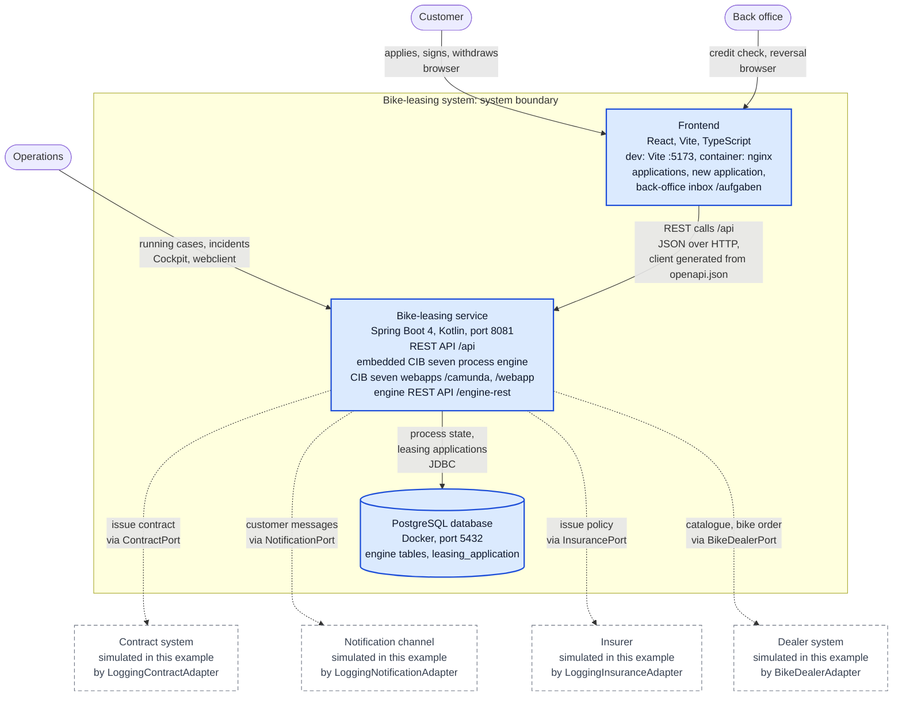
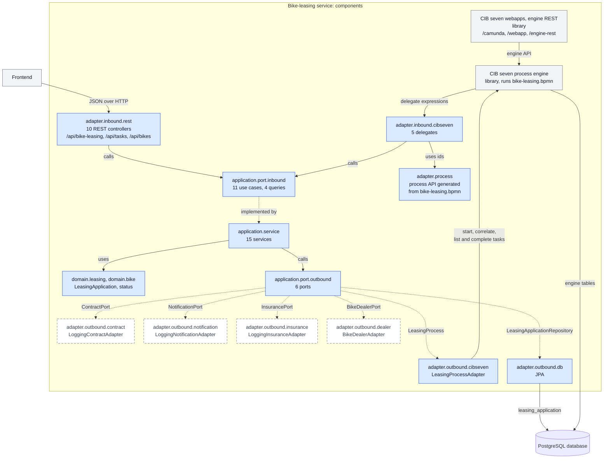

# C4 containers and components (Level 2 and 3): bike-leasing system

designIQ shows this file as plain text; GitHub renders the diagrams.

This view zooms into the one box of the [system context](c4-system-context.md): first the containers,
then the components inside the service. It draws only what runs today.

## Container view (Level 2)

A C4 container is a unit you deploy and run on its own. The system has three:

- the **Frontend**, a React single-page app ([ADR-0009][adr9]). In development the Vite dev server
  serves it on port 5173 and proxies `/api`, `/v3/api-docs`, `/engine-rest`, `/camunda` and `/webapp`
  to the service, so the browser sees one origin. In a container, nginx serves the built app and proxies the
  same paths ([Dockerfile][fe-docker], [nginx.conf][fe-nginx]; port 8090 in
  [docker-compose.full.yml][compose-full]).
- the **Bike-leasing service**. The REST API, the CIB seven process engine and the CIB seven webapps
  run in one Spring Boot application, in one JVM, from one jar. So they are one container; its parts
  are in the [component view](#component-view-level-3).
- the **PostgreSQL database**.

Dashed: simulated in this example. The invisible `~~~` links only keep the external systems below
the boundary. The dealer's handover report has no arrow of its own: today it arrives through the
frontend ("report handover" on the application page) or the REST API, as the
[system context](c4-system-context.md) says.

| Element | What it is | Origin in the process | Source in the repo |
|---|---|---|---|
| Frontend | React, Vite, TypeScript, TanStack Router and Query, Tailwind; Feature-Sliced Design. German and English copy (German unless the browser is English; switch with "language"). Pages: application list (`/`), new application (`/antraege/neu`), application detail (`/antraege/{id}`, with sign, report handover and withdraw), back-office inbox (`/aufgaben`). orval generates its API client from the [OpenAPI contract][openapi]. | Leasing request received, Contract signed, Handover reported, Application withdrawn; the two user tasks Check credit rating and Reverse application in the inbox | [frontend/AGENTS.md][fe], [vite.config.ts][fe-vite], [frontend/src][fe-src] |
| Bike-leasing service | Spring Boot 4 application in Kotlin (JVM 21), started with `./gradlew bootRun` on port 8081. Serves the REST API `/api/bike-leasing`, `/api/tasks` and `/api/bikes` (Swagger UI `/swagger-ui.html`), Cockpit, Tasklist and Admin at `/camunda`, the webclient at `/webapp` (both admin/admin), the engine REST API `/engine-rest` and Actuator `/actuator`. | Deploys and runs `bike-leasing.bpmn`; every step of the process runs here. | [build.gradle.kts][build], [application.yaml][yaml], [CibsevenBikeLeasingApplication][main] |
| PostgreSQL database | `postgres:18.6` in Docker, port 5432, database `bikeleasing`. Holds the engine's own tables and the table `leasing_application` (Flyway). Engine and services write in one transaction. Tests use in-memory H2 instead. | The wait states persist here: Check credit rating, Contract signed, Handover reported, Reverse application. So does the status of each case. | [docker-compose.yml][compose], [Flyway migrations][migrations] |

The external systems are described in the [system context](c4-system-context.md#elements).

### From process elements to containers

| Process element | Where it lives today |
|---|---|
| Start event Leasing request received | The frontend form, which calls the REST API of the service |
| User tasks Check credit rating, Reverse application | The frontend inbox, which completes them through domain endpoints of the service ([ADR-0010][adr10]); no Camunda Form |
| Service tasks, gateways, the event subprocess Application withdrawn | Delegates and application services in the service, run by the engine |
| Wait states Contract signed, Handover reported | The process engine; their state is in PostgreSQL. The frontend buttons correlate the messages through the REST API. |
| External parties: contract, notification, insurer, dealer | Outside the boundary, simulated ([#8][i8], [#9][i9], [#10][i10]) |

## Component view (Level 3)

Inside the Bike-leasing service. Every blue box is a package under
`service/app/src/main/kotlin/io/miragon/blueprint/`; the two grey boxes are CIB seven libraries; the dashed boxes
are the packages of the simulated adapters. Solid arrows: calls or uses. Dotted arrows: implemented
by. The architecture tests ([ArchitectureTest][arch]) enforce these directions.

The Frontend box is the container from the view above, drawn grey only to show where the calls come
from.

| Component | What it is | Origin in the process | Source in the repo |
|---|---|---|---|
| `adapter.inbound.rest` | 10 controllers: submit, list, get, sign, report handover, withdraw (`/api/bike-leasing`), the credit-check and reversal completions (`/api/bike-leasing/{id}/credit-check`, `.../reversal`), the open tasks (`/api/tasks`) and the catalogue (`/api/bikes`). Errors become problem details: 400 invalid input, 404 unknown application, 409 when the state forbids the action, the task is not open or a job updated the case at the same time. Also the metadata of the [OpenAPI contract][openapi]. | Leasing request received, Contract signed, Handover reported, Application withdrawn, Check credit rating, Reverse application; reading applications, tasks and bikes | [adapter/inbound/rest][pkg-rest] |
| `adapter.inbound.cibseven` | 5 JavaDelegates the engine calls by delegate expression, such as `#{sendContractDelegate}`. `ValidateApplicationDelegate` turns an invalid application into the BPMN error `applicationInvalid`. | Validate application, Send contract, Issue insurance policy, Order bike from dealer, Send rejection | [adapter/inbound/cibseven][pkg-delegates] |
| `application.port.inbound` | One interface per use case: 11 use cases and the queries `GetLeasingApplicationQuery`, `ListLeasingApplicationsQuery`, `ListOpenTasksQuery`, `ListBikesQuery`. | Called over REST: submit, sign contract, report handover, withdraw, complete credit check, complete reversal. Called by the engine: validate, send contract, issue insurance policy, order bike, reject. | [application/port/inbound][pkg-in] |
| `application.service` | One service per use case or query; transactional, so domain writes and engine state commit together. | The same steps | [application/service][pkg-service] |
| `domain.leasing`, `domain.bike` | `LeasingApplication` with its status and value objects; `BackOfficeTask`; `Bike`. | The status follows the process: RECEIVED, CONTRACT_SENT, CONTRACT_SIGNED (policy and order running), ORDERED, ACTIVE (Leasing active), or REJECTED (Application rejected); WITHDRAWN after Application withdrawn (only from a running state), CANCELLED (Application cancelled) after the reversal | [domain][pkg-domain] |
| `application.port.outbound` | 6 ports the services call: `LeasingApplicationRepository`, `LeasingProcess`, `ContractPort`, `NotificationPort`, `InsurancePort`, `BikeDealerPort`. | See the adapters below | [application/port/outbound][pkg-out] |
| `adapter.outbound.db` | JPA entity, mapper and repository for the table `leasing_application`. | Keeps the status of each case | [adapter/outbound/db][pkg-db] |
| `adapter.outbound.cibseven` | `LeasingProcessAdapter`: starts the process by message, correlates messages by business key (the application id), lists the open user tasks and completes them. | Leasing request received, Contract signed, Handover reported, Application withdrawn, Check credit rating, Reverse application | [adapter/outbound/cibseven][pkg-cib] |
| `adapter.outbound.contract` | `LoggingContractAdapter` simulates the contract system: it logs and returns `CONTRACT-<uuid>`. | Send contract | [adapter/outbound/contract][pkg-contract] |
| `adapter.outbound.notification` | `LoggingNotificationAdapter` simulates the notification channel: it logs the message. | Send contract, Send rejection | [adapter/outbound/notification][pkg-notification] |
| `adapter.outbound.insurance` | `LoggingInsuranceAdapter` simulates the insurer: it logs and returns `POLICY-<uuid>`. | Issue insurance policy | [adapter/outbound/insurance][pkg-insurance] |
| `adapter.outbound.dealer` | `BikeDealerAdapter` simulates the dealer system: a fixed catalogue (`BIKE-900`, `BIKE-800`, `BIKE-600`, `BIKE-FAIL`); `BIKE-FAIL` is an outage, every other bike gets `ORDER-<uuid>`. | Order bike from dealer; the catalogue for Validate application | [adapter/outbound/dealer][pkg-dealer] |
| `adapter.process` | Process API that bpmn-to-code generates from the BPMN before every compile: typed element ids, messages, variables, errors and delegate expressions. Never edited by hand. Delegates and `LeasingProcessAdapter` use it. The package also holds one hand-written engine plugin, `HistoryCleanupConfiguration`. | Every element id of `bikeLeasingProcess` | [adapter/process][pkg-process], [build.gradle.kts][build] |
| CIB seven process engine (library) | Embedded engine from the CIB seven Spring Boot starter. Deploys every `*.bpmn` and `*.dmn` on the classpath (today only `bike-leasing.bpmn`) and runs messages, the event subprocess, async jobs and retries. | The whole process; the retry cycle `R3/PT10S` on Order bike from dealer | [libs.versions.toml][libs], [application.yaml][yaml] |
| CIB seven webapps and engine REST (library) | Cockpit, Tasklist and Admin at `/camunda`, webclient at `/webapp`, engine REST API at `/engine-rest`; login admin/admin. For operations, not the back office's workplace ([ADR-0010][adr10]). | Incidents and running cases (Cockpit) | [libs.versions.toml][libs], [application.yaml][yaml] |

## What changes with the planned features

Not drawn above; each issue describes its change.

- [#18 Signature deadline][i18] and [#1 Signature reminder][i1]: timers in the engine, no new box.
  #1 sends one more message through `NotificationPort`.
- [#19 Credit check by DMN][i19]: the decision `checkCreditRating` is deployed again and runs in
  the engine; the credit check leaves the inbox unless a manual fallback is kept.
- [#20 Alternative bike][i20]: `BikeDealerPort` gains an availability check, and the inbox gets a
  third task type with its own domain endpoint.
- [#21 Withdrawal period][i21]: a 14-day timer in the engine and the status `HANDED_OVER` in the
  domain and the frontend; no new container.
- [#3 Automatic reversal][i3]: compensation in the engine; `ContractPort` and `InsurancePort` gain
  revoke and cancel operations, and the reversal task leaves the inbox.
- [#4 Bike order cancellation][i4]: the dealer edge gains order cancellation; the inbox gets a
  return-clarification task.
- [#7 Live dealer availability][i7]: a bike-portfolio table in PostgreSQL (new Flyway migration),
  and `GET /api/bikes` asks the dealer for availability.
- [#8 Contract & e-signature][i8], [#9 Customer notification][i9], [#10 Dealer integration][i10]:
  decide what replaces each simulated adapter. Make pulls the capability inside the boundary; buy or
  adapt turns the dashed box into a real external system. With a bought e-signature service, for
  example, the signature would arrive from the contract system instead of the customer's button.

[adr9]: ../adr/0009-react-frontend-next-to-the-service.md
[adr10]: ../adr/0010-back-office-task-ui-own-inbox-in-the-frontend.md
[fe]: ../../frontend/AGENTS.md
[fe-src]: ../../frontend/src/
[fe-vite]: ../../frontend/vite.config.ts
[fe-docker]: ../../frontend/Dockerfile
[fe-nginx]: ../../frontend/nginx.conf
[compose-full]: ../../stack/docker-compose.full.yml
[build]: ../../service/app/build.gradle.kts
[libs]: ../../gradle/libs.versions.toml
[yaml]: ../../service/app/src/main/resources/application.yaml
[main]: ../../service/app/src/main/kotlin/io/miragon/blueprint/CibsevenBikeLeasingApplication.kt
[compose]: ../../stack/docker-compose.yml
[migrations]: ../../service/app/src/main/resources/db/migration/
[openapi]: ../../openapi/openapi.json
[arch]: ../../service/app/src/test/kotlin/io/miragon/blueprint/ArchitectureTest.kt
[pkg-rest]: ../../service/app/src/main/kotlin/io/miragon/blueprint/adapter/inbound/rest/
[pkg-delegates]: ../../service/app/src/main/kotlin/io/miragon/blueprint/adapter/inbound/cibseven/
[pkg-in]: ../../service/app/src/main/kotlin/io/miragon/blueprint/application/port/inbound/
[pkg-service]: ../../service/app/src/main/kotlin/io/miragon/blueprint/application/service/
[pkg-domain]: ../../service/app/src/main/kotlin/io/miragon/blueprint/domain/
[pkg-out]: ../../service/app/src/main/kotlin/io/miragon/blueprint/application/port/outbound/
[pkg-db]: ../../service/app/src/main/kotlin/io/miragon/blueprint/adapter/outbound/db/
[pkg-cib]: ../../service/app/src/main/kotlin/io/miragon/blueprint/adapter/outbound/cibseven/
[pkg-contract]: ../../service/app/src/main/kotlin/io/miragon/blueprint/adapter/outbound/contract/
[pkg-notification]: ../../service/app/src/main/kotlin/io/miragon/blueprint/adapter/outbound/notification/
[pkg-insurance]: ../../service/app/src/main/kotlin/io/miragon/blueprint/adapter/outbound/insurance/
[pkg-dealer]: ../../service/app/src/main/kotlin/io/miragon/blueprint/adapter/outbound/dealer/
[pkg-process]: ../../service/app/src/main/kotlin/io/miragon/blueprint/adapter/process/
[i1]: https://github.com/miragon-blueprints/miragon-ai-example/issues/1
[i3]: https://github.com/miragon-blueprints/miragon-ai-example/issues/3
[i4]: https://github.com/miragon-blueprints/miragon-ai-example/issues/4
[i7]: https://github.com/miragon-blueprints/miragon-ai-example/issues/7
[i8]: https://github.com/miragon-blueprints/miragon-ai-example/issues/8
[i9]: https://github.com/miragon-blueprints/miragon-ai-example/issues/9
[i10]: https://github.com/miragon-blueprints/miragon-ai-example/issues/10
[i18]: https://github.com/miragon-blueprints/miragon-ai-example/issues/18
[i19]: https://github.com/miragon-blueprints/miragon-ai-example/issues/19
[i20]: https://github.com/miragon-blueprints/miragon-ai-example/issues/20
[i21]: https://github.com/miragon-blueprints/miragon-ai-example/issues/21
