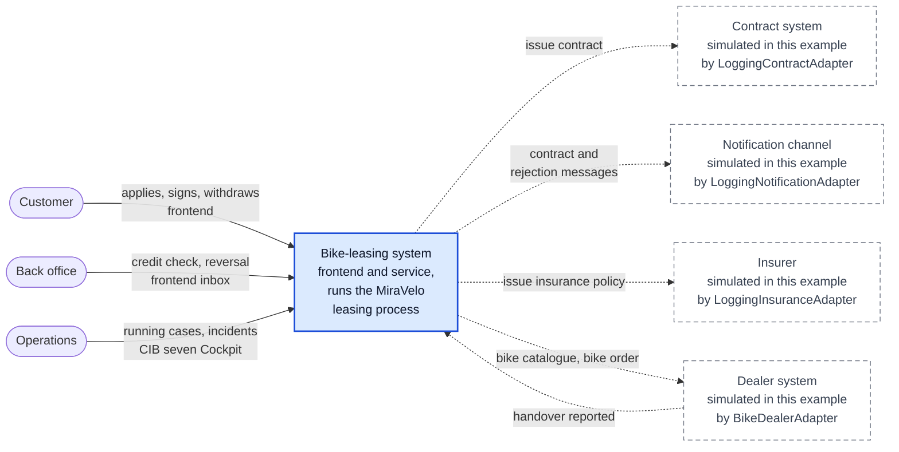

# C4 system context (Level 1): bike-leasing system

designIQ shows this file as plain text; GitHub renders the diagram.

Who works with the bike-leasing system, and which systems does it talk to? One box in the middle,
everyone involved at the edge. The view shows the process that runs today
([executable model][bpmn]). The next zoom level is the [container view](c4-container.md).

Solid: real today. Dashed: simulated in this example. The service really calls each port, but the
adapter behind it only logs (contract, notification, insurer) or plays a dealer with a fixed
catalogue. Nobody plays the dealer's own system: the handover is reported with the "report
handover" button on the application page of the frontend, or by the [Bruno scenarios][bruno] on the
REST API.

## Four questions behind the picture

| Question | Answer in this example |
|---|---|
| Where does the customer submit the request? | In the frontend (`/antraege/neu`), which calls the REST API `/api/bike-leasing`. The same page lists the applications and shows each one with its actions (sign, withdraw). |
| Which roles work at the edge of the process? | The back office decides the credit check and confirms the reversal in the frontend inbox (`/aufgaben`, [ADR-0019][adr19]). Operations watches running cases and incidents in the CIB seven Cockpit of the webclient (`/webapp/#/seven/auth/start`). |
| Which systems deliver or receive data? | Contract system, notification channel, insurer and dealer system, all simulated. Make, buy or adapt is open for three of them: [#8 Contract & e-signature][i8], [#9 Customer notification][i9], [#10 Dealer integration][i10]. **Assumption:** the insurer is a partner whose integration has no decision issue yet. |
| Where does the process control live? | In the CIB seven engine embedded in the service ([container view](c4-container.md)). The credit check is no external system and no rule: a person decides it in the inbox. Automating it with the DMN `checkCreditRating` is [#19][i19]. |

Outside the box sits what this system does not build. A make decision in #8 to #10 would pull a
capability inside; a buy or adapt decision turns a dashed box into a real system.

## Elements

The step names are the same in the [t.BPM model][tbpm] and the [executable model][bpmn]; the ids in
brackets are the executable ones.

| Element | What it is | Origin in the process | Source in the repo |
|---|---|---|---|
| Customer | The person applying for a lease. Submits the application, signs the contract, may withdraw, receives the messages. | Leasing request received (`startEvent_leasingRequestReceived`), Contract signed (`event_contractSigned`), Application withdrawn (`startEvent_applicationWithdrawn`) | frontend pages [submit-application][fe-submit], [application-detail][fe-detail]; [SubmitLeasingRequestController][submit], [SignContractController][sign], [WithdrawApplicationController][withdraw] |
| Back office | MiraVelo staff who decide the credit check and reverse a withdrawn application. | Check credit rating (`userTask_checkCreditRating`), Reverse application (`userTask_reverseApplication`) | frontend page [task-inbox][fe-inbox]; [ListOpenTasksController][tasks], [CompleteCreditCheckController][credit], [CompleteReversalController][reversal] |
| Operations | Whoever watches running cases and incidents and retries failed jobs. | No step of its own. A dealer outage on Order bike from dealer (`serviceTask_orderBike`) retries three times (`R3/PT10S`), then raises an incident. | [application.yaml][yaml] (webapps), [DealerOutageIncidentTest][incident] |
| Bike-leasing system | The system in scope: the frontend for customer and back office, and the service that runs the process and keeps the leasing applications. | The whole process `bikeLeasingProcess` | [bike-leasing.bpmn][bpmn], [service/app/src/main/kotlin][src], [frontend/][fe] |
| Contract system (simulated) | Issues the leasing contract. Simulated: logs and returns `CONTRACT-<uuid>`. Nothing revokes a contract today. | Send contract (`serviceTask_sendContract`) | [ContractPort][contract-port], [LoggingContractAdapter][contract-adapter] |
| Notification channel (simulated) | Sends messages to the customer. Simulated: logs `Notifying <email>: <subject>`. | Send contract, Send rejection (`serviceTask_sendRejection`) | [NotificationPort][notification-port], [LoggingNotificationAdapter][notification-adapter] |
| Insurer (simulated) | Issues the insurance policy for the leased bike. Simulated: logs and returns `POLICY-<uuid>`. | Issue insurance policy (`serviceTask_issueInsurancePolicy`) | [InsurancePort][insurance-port], [LoggingInsuranceAdapter][insurance-adapter] |
| Dealer system (simulated) | Offers the bike catalogue, takes the bike order, reports the handover. Simulated: four catalogue bikes; `BIKE-FAIL` is an outage, every other bike is ordered. | Order bike from dealer (`serviceTask_orderBike`), Handover reported (`event_handoverReported`); the catalogue is read on submission, so Validate application (`serviceTask_validateApplication`) can reject an unknown bike | [BikeDealerPort][dealer-port], [BikeDealerAdapter][dealer-adapter], [ReportHandoverController][handover] |

[bpmn]: ../use-cases/bike-leasing/process/bike-leasing.bpmn
[tbpm]: ../use-cases/bike-leasing/tbpm/bike-leasing-tbpm.bpmn
[bruno]: ../../bruno/README.md
[adr19]: ../adr/0019-back-office-task-ui-own-inbox-in-the-frontend.md
[yaml]: ../../service/app/src/main/resources/application.yaml
[src]: ../../service/app/src/main/kotlin/io/miragon/blueprint/
[fe]: ../../frontend/AGENTS.md
[fe-submit]: ../../frontend/src/pages/submit-application/
[fe-detail]: ../../frontend/src/pages/application-detail/
[fe-inbox]: ../../frontend/src/pages/task-inbox/
[submit]: ../../service/app/src/main/kotlin/io/miragon/blueprint/adapter/inbound/rest/SubmitLeasingRequestController.kt
[sign]: ../../service/app/src/main/kotlin/io/miragon/blueprint/adapter/inbound/rest/SignContractController.kt
[withdraw]: ../../service/app/src/main/kotlin/io/miragon/blueprint/adapter/inbound/rest/WithdrawApplicationController.kt
[tasks]: ../../service/app/src/main/kotlin/io/miragon/blueprint/adapter/inbound/rest/ListOpenTasksController.kt
[credit]: ../../service/app/src/main/kotlin/io/miragon/blueprint/adapter/inbound/rest/CompleteCreditCheckController.kt
[reversal]: ../../service/app/src/main/kotlin/io/miragon/blueprint/adapter/inbound/rest/CompleteReversalController.kt
[handover]: ../../service/app/src/main/kotlin/io/miragon/blueprint/adapter/inbound/rest/ReportHandoverController.kt
[contract-port]: ../../service/app/src/main/kotlin/io/miragon/blueprint/application/port/outbound/ContractPort.kt
[contract-adapter]: ../../service/app/src/main/kotlin/io/miragon/blueprint/adapter/outbound/contract/LoggingContractAdapter.kt
[notification-port]: ../../service/app/src/main/kotlin/io/miragon/blueprint/application/port/outbound/NotificationPort.kt
[notification-adapter]: ../../service/app/src/main/kotlin/io/miragon/blueprint/adapter/outbound/notification/LoggingNotificationAdapter.kt
[insurance-port]: ../../service/app/src/main/kotlin/io/miragon/blueprint/application/port/outbound/InsurancePort.kt
[insurance-adapter]: ../../service/app/src/main/kotlin/io/miragon/blueprint/adapter/outbound/insurance/LoggingInsuranceAdapter.kt
[dealer-port]: ../../service/app/src/main/kotlin/io/miragon/blueprint/application/port/outbound/BikeDealerPort.kt
[dealer-adapter]: ../../service/app/src/main/kotlin/io/miragon/blueprint/adapter/outbound/dealer/BikeDealerAdapter.kt
[incident]: ../../service/app/src/test/kotlin/io/miragon/blueprint/adapter/process/DealerOutageIncidentTest.kt
[i8]: https://github.com/miragon-blueprints/miragon-ai-example/issues/8
[i9]: https://github.com/miragon-blueprints/miragon-ai-example/issues/9
[i10]: https://github.com/miragon-blueprints/miragon-ai-example/issues/10
[i19]: https://github.com/miragon-blueprints/miragon-ai-example/issues/19
