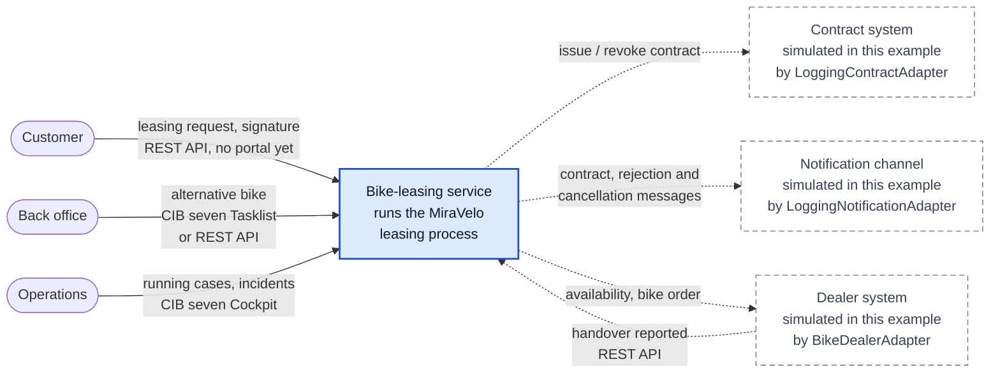

# C4 system context (Level 1): bike-leasing service

designIQ shows this file as plain text; GitHub renders the diagram.

Who works with the bike-leasing service, and which systems does it talk to? One box in the middle,
everyone involved at the edge. The view shows the core process that runs today
([executable model][bpmn]). The next zoom level is the [container view](c4-container.md).

Solid: real today. Dashed: simulated in this example. The service really calls each port, but the
adapter behind it only logs (contract, notification) or plays a dealer with fixed answers. Today the
[Bruno scenarios][bruno] play the customer and the dealer on the REST API.

## Four questions behind the picture

| Question | Answer in this example |
|---|---|
| Where does the customer submit the request? | On the REST API `/api/bike-leasing`. There is no portal yet; [#6 Application list][i6] and [#7 Bike catalogue][i7] add read models a portal would need. |
| Which roles work at the edge of the process? | The back office clarifies an alternative bike in the CIB seven Tasklist or on the REST API; which way stays is [#11 Back-office task UI][i11]. Operations watches running cases and incidents in the Cockpit. |
| Which systems deliver or receive data? | Contract system, notification channel and dealer system, all simulated. Make, buy or adapt is open: [#8 Contract & e-signature][i8], [#9 Customer notification][i9], [#10 Dealer integration][i10]. |
| Where does the process control live? | In the CIB seven engine embedded in the service ([container view](c4-container.md)). The credit check is no external system: the DMN table `checkCreditRating` runs inside the service. |

Outside the box sits what this service does not build. A make decision in #8 to #10 would pull a
capability inside; a buy or adapt decision turns a dashed box into a real system.

## Elements

The step names are the same in the [t.BPM model][tbpm] and the [executable model][bpmn]; the ids in
brackets are the executable ones.

| Element | What it is | Origin in the process | Source in the repo |
|---|---|---|---|
| Customer | The person applying for a lease. Submits the request, signs the contract, receives the messages. | Leasing request received (`startEvent_leasingRequestReceived`), Contract signed (`event_contractSigned`) | [SubmitLeasingRequestController][submit], [SignContractController][sign] |
| Back office | MiraVelo staff who clarify an alternative bike with the customer when the dealer has none in stock. | Clarify alternative with customer (`userTask_clarifyAlternative`) | [clarify-alternative.form][form] (Tasklist), [SelectAlternativeController][select] (REST) |
| Operations | Whoever watches running cases and incidents and retries failed jobs. | No step of its own. A dealer outage on Order bike from dealer (`serviceTask_orderBike`) retries three times (`R3/PT10S`), then raises an incident. | [application.yaml][yaml] (webapps), [DealerOutageIncidentTest][incident] |
| Bike-leasing service | The system in scope: runs the process and keeps the leasing applications. | The whole process `bikeLeasingProcess`, including Check credit rating (`businessRuleTask_checkCreditRating`, DMN `checkCreditRating`) | [bike-leasing.bpmn][bpmn], [checkCreditRating.dmn][dmn], [src/main/kotlin][src] |
| Contract system (simulated) | Issues and revokes the leasing contract. Simulated: logs and returns `CONTRACT-<uuid>`. | Send contract (`serviceTask_sendContract`), Cancel contract (`serviceTask_cancelContract`) | [ContractPort][contract-port], [LoggingContractAdapter][contract-adapter] |
| Notification channel (simulated) | Sends messages to the customer. Simulated: logs `Notifying <email>: <subject>`. | Send contract, Send rejection (`serviceTask_sendRejection`), Send cancellation confirmation (`serviceTask_confirmContractCancellation`) | [NotificationPort][notification-port], [LoggingNotificationAdapter][notification-adapter] |
| Dealer system (simulated) | Checks availability, takes the bike order, reports the handover. Simulated: `BIKE-OOS` is out of stock, `BIKE-FAIL` is an outage, every other bike is ordered. | Order bike from dealer (`serviceTask_orderBike`), Bike unavailable (`event_bikeUnavailable`), Handover reported (`event_handoverReported`) | [BikeDealerPort][dealer-port], [BikeDealerAdapter][dealer-adapter], [ReportHandoverController][handover] |

[bpmn]: ../use-cases/bike-leasing/process/bike-leasing.bpmn
[dmn]: ../use-cases/bike-leasing/process/checkCreditRating.dmn
[tbpm]: ../use-cases/bike-leasing/tbpm/bike-leasing-tbpm.bpmn
[bruno]: ../../bruno/README.md
[form]: ../../src/main/resources/forms/clarify-alternative.form
[yaml]: ../../src/main/resources/application.yaml
[src]: ../../src/main/kotlin/io/miragon/blueprint/
[submit]: ../../src/main/kotlin/io/miragon/blueprint/adapter/inbound/rest/SubmitLeasingRequestController.kt
[sign]: ../../src/main/kotlin/io/miragon/blueprint/adapter/inbound/rest/SignContractController.kt
[select]: ../../src/main/kotlin/io/miragon/blueprint/adapter/inbound/rest/SelectAlternativeController.kt
[handover]: ../../src/main/kotlin/io/miragon/blueprint/adapter/inbound/rest/ReportHandoverController.kt
[contract-port]: ../../src/main/kotlin/io/miragon/blueprint/application/port/outbound/ContractPort.kt
[contract-adapter]: ../../src/main/kotlin/io/miragon/blueprint/adapter/outbound/contract/LoggingContractAdapter.kt
[notification-port]: ../../src/main/kotlin/io/miragon/blueprint/application/port/outbound/NotificationPort.kt
[notification-adapter]: ../../src/main/kotlin/io/miragon/blueprint/adapter/outbound/notification/LoggingNotificationAdapter.kt
[dealer-port]: ../../src/main/kotlin/io/miragon/blueprint/application/port/outbound/BikeDealerPort.kt
[dealer-adapter]: ../../src/main/kotlin/io/miragon/blueprint/adapter/outbound/dealer/BikeDealerAdapter.kt
[incident]: ../../src/test/kotlin/io/miragon/blueprint/process/DealerOutageIncidentTest.kt
[i6]: https://github.com/miragon-blueprints/miragon-ai-example/issues/6
[i7]: https://github.com/miragon-blueprints/miragon-ai-example/issues/7
[i8]: https://github.com/miragon-blueprints/miragon-ai-example/issues/8
[i9]: https://github.com/miragon-blueprints/miragon-ai-example/issues/9
[i10]: https://github.com/miragon-blueprints/miragon-ai-example/issues/10
[i11]: https://github.com/miragon-blueprints/miragon-ai-example/issues/11
